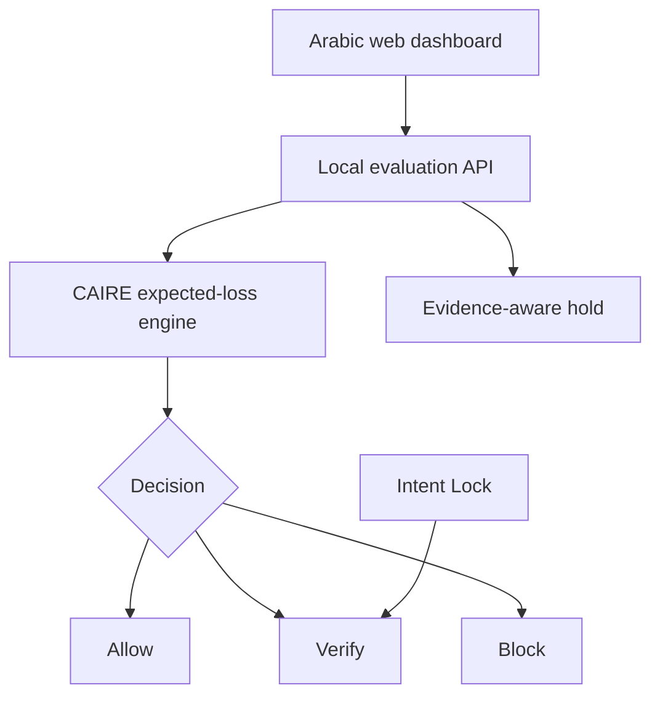

# Guardian X — PRISM V16 🛡️

**Risk-aware authorization · Evidence-based decisions · Explainable security**

> نظام حارس X هو نموذج بحثي للأمن السيبراني يساعد على اتخاذ قرارات قابلة للتفسير: السماح، طلب تحقق إضافي، المنع، أو الانتظار للحصول على دليل أفضل.

Guardian X is an **offline-first, research-stage prototype** for cost-aware security decisions. It demonstrates transaction-bound authorization, Bayesian value of information, mixed attacker models, and randomized audits. **It is not production-ready financial security software.**

## ✨ Highlights / مميزات المشروع

| المكوّن | What it does | Status |
|---|---|---|
| **Intent Lock** | One-time, expiring HMAC tokens tied to user and exact transaction details | Prototype |
| **CAIRE** | Minimizes expected loss over allow / verify / block | Implemented |
| **Mixed Threat Model** | Weighted post-verification attacker success rates | Implemented |
| **Value of Waiting** | Bayesian hold/continue decision based on signal quality | Implemented |
| **Randomized Audit** | Samples otherwise-allowed transactions | Simulation |
| **Fatigue Guard** | Rate-limits repeat challenges and models fatigue risk | Prototype |
| **Acceptance Tests** | Tests T01–T14 | 14 passing locally |

## 🧩 Architecture / البنية



### Research report / التقرير البحثي

Read the **[six-page PRISM V16 project report](PROJECT_REPORT.pdf)** covering the research problem, quantitative assumptions, architecture, acceptance-test evidence, and development roadmap.

## 🚀 Quick start / التشغيل

1. نزّل الملفات أو استنسخ المستودع ثم افتح المجلد في VS Code.
2. افتح Terminal ونفّذ:

   ```powershell
   py -3.11 app.py
   ```

3. افتح `http://127.0.0.1:8765` في المتصفح.
4. للاختبارات:

   ```powershell
   py -3.11 -m unittest discover -v
   ```

The runtime needs **Python 3.11+ and no third-party Python packages**. PDF regeneration, unlike app execution, requires PyMuPDF. Use `python` instead of `py -3.11` where appropriate. Stop the server using `Ctrl+C`.

## ما يعمل الآن

- محاكاة السماح / التحقق / المنع وفق الحد الأدنى للخسارة المتوقعة.
- المهاجم المختلط: سرقة كلمة مرور (50% × 2%)، سرقة جلسة (30% × 3%)، احتيال بالإقناع (20% × قيمة قابلة للتغيير).
- قرار الانتظار الاحتمالي مع حساسية الإشارة والإنذار الكاذب ومستوى الدليل.
- موافقات HMAC مقيدة بالمستخدم وتفاصيل المعاملة والمدة، تستهلك مرة واحدة.
- تدقيق عشوائي قابل للضبط ومحاكاة بسيطة لمهاجم يعرف العتبة.
- محدِّد إرهاق التحقق، واختبارات T01-T14.

## المعادلات

حيث `p` احتمال الهجوم، و`r` احتمال نجاحه **بعد** التحقق:

- `L_allow = 9000*p`
- `L_verify = 9000*r*p + 40*(1-p)`
- `L_block = 600*(1-p)`
- `p_allow→verify = 40 / (9000*(1-r)+40)`
- `p_verify→block = 560 / (9000*r+560)`

في المثال المختلط `r = 0.099`، وعتبة التحقق/المنع ≈ `38.59%`.

**تنبيه علمي:** عدد `r` هو معدل النجاح المتبقي بعد التحقق؛ لذلك فاعلية إيقاف الهجوم هي `1-r`. الرموز دقيقة هنا لتجنب الخلط. جميع التكاليف والمعلمات توضيحية وليست ناتجة عن تجربة ميدانية.

## حدود النسخة

لا يوجد تكامل حقيقي مع البنوك أو Passkeys أو أجهزة مستخدمين، ولا ML مدرب، ولا احتساب لمعدل كشف حقيقي. واجهة المستخدم محاكاة قرار وليست لوحة مراقبة حوادث فعلية. لا يصلح الكود كما هو للتشغيل الإنتاجي. يحتاج نشرًا آمنًا، ومخزن بيانات دائمًا لرموز الموافقة المستهلكة، وإدارة مفاتيح آمنة، ونموذج تهديد موسعًا، وتقييمًا مستقلًا.

**Security note:** Demo signatures are not a substitute for WebAuthn/Passkey authentication. Nonce replay state is in memory only. Do not submit real identities, credentials, financial records, or customer data to this prototype.

## الملفات

| الملف | الوظيفة |
|---|---|
| `app.py` | خادم الواجهة وواجهة API المحلية |
| `index.html` | واجهة عربية احترافية متجاوبة |
| `guardian.py` | محرك القرار والتوثيق والانتظار والتدقيق |
| `test_guardian.py` | 14 اختبار قبول |
| `PROJECT_REPORT.pdf` | تقرير العرض البحثي |
| `BUILD_PROMPT.md` | تعليمات تطوير النسخة التالية |
| `report.html` / `make_pdf.py` | Editable report source and PDF generation |

## أهداف النسخة التالية

R1: تحويل Intent Lock إلى خدمة تعتمد على FIDO2/WebAuthn، مع تخزين حالة آمن واختبارات تكامل. R5: بيانات محاكاة أغنى، GuardianBench مقارن، مقاييس ثقة، واختبار هجومي مأذون. لا يُعلن نجاح أي منها قبل تنفيذها وقياسها.

## 📌 Research integrity

All listed costs, attacker shares, success rates, and evidence quality estimates are **illustrative assumptions**. Passing tests only demonstrates conformance to the implemented scenarios. No field effectiveness, detection rate, patent novelty, or production assurance is claimed.

## Project description

*Guardian X PRISM is a bilingual, research-stage cybersecurity prototype for explainable, cost-aware transaction authorization and evidence-based fraud response.*
